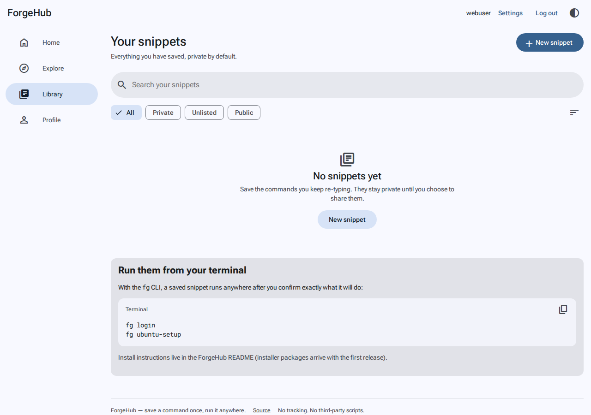

# ForgeHub

**Save a shell command once. Run it anywhere.**

ForgeHub is a cloud home for shell command snippets: a web app
and server for sharing them, plus a fast Rust CLI —
`forgehub`, aliased to **`fg`** — that runs them with a safety
model built for other people's code.

```console
$ fg ubuntu-setup
```

That fetches the snippet, shows you **exactly** what will run —
owner, version, content hash, every command numbered — and
asks before executing anything. Your own snippets ask
`[y/N]`; someone else's ask you to type `yes` the first time,
and any later change shows a diff and asks again.



## 60-second quickstart

**CLI** (after installing, below):

```console
$ forgehub alias install     # adds the `fg` alias
$ fg init
$ fg record hello            # a capture shell opens: run `echo hello`, then `exit`
$ fg hello                   # shows the commands, asks [y/N], runs
```

**Web + server**:

```console
$ git clone https://github.com/aotlover9-base-eth/forgehub.git
$ cd forgehub && cp .env.example .env   # set FORGEHUB_SECRET_KEY
$ docker compose up -d --build          # https via Caddy; docs/deploy.md
```

Then connect the CLI to your server:

```console
$ fg login                   # device-code flow in your browser
$ fg push hello --public     # share it
$ fg run alice/docker-setup  # anyone's public snippet, with the trust flow
```

## Install

Checksum-verifying installer (short, commented — read it
before running it, that's the ForgeHub way):

```console
$ curl -fsSL https://raw.githubusercontent.com/aotlover9-base-eth/forgehub/main/scripts/install.sh -o install.sh
$ less install.sh
$ sh install.sh
```

From source (Rust 1.x): `cargo install --path crates/forge-cli`.
Server deployment: [docs/deploy.md](docs/deploy.md).

## The safety model, in plain words

- **Nothing runs unseen.** Every cloud run displays the full
  command list first. There is no silent mode for other
  people's snippets.
- **Trust is pinned to content.** Approving a snippet approves
  its exact hash. If the content changes, you see a diff and
  approve again — `-y` never skips a first run or a change.
- **No terminal, no run.** Without an interactive terminal,
  unskippable confirmations fail closed (exit 2) instead of
  guessing.
- **Secrets are blocked, not leaked.** A scanner checks
  snippets at record, push and web-save time and refuses
  likely credentials — findings name the kind and line, never
  the value.
- **Passwords and tokens are hashed** (argon2id; SHA-256 at
  rest), sessions are revocable, and there is **no telemetry**
  and no third-party scripts or fonts in the web app.

Full detail: [docs/security.md](docs/security.md) and the
threat model in [docs/threat-model.md](docs/threat-model.md).

## Documentation

- [User guide](docs/user-guide.md) — web and CLI, start to finish
- [CLI reference](docs/cli-reference.md) — every command and flag
- [API](docs/api.md) + [OpenAPI spec](docs/openapi.yaml)
- [Self-hosting](docs/self-hosting.md) · [Deploy](docs/deploy.md) · [Operations](docs/operations.md)
- [Migrating from Forgenesis](docs/forgenesis-migration.md)
- [FAQ](docs/faq.md) · [Known gaps](docs/known-gaps.md)
- [Security policy](SECURITY.md) · [Contributing](CONTRIBUTING.md) · [Changelog](CHANGELOG.md)

## Status

v0.1.0 — feature-complete and audited. 22 build steps, one
commit each; the record is in [PROGRESS.md](PROGRESS.md) and
[reports/](reports/).

## Licence

MIT — see [LICENSE](LICENSE).
