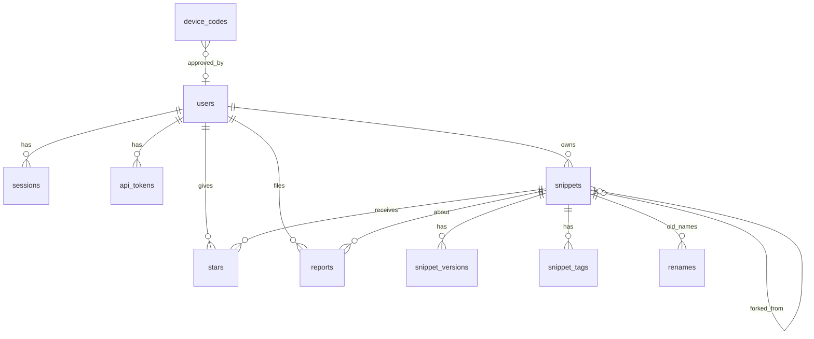

# Spec - Data model

- **Status:** Normative for Step 6 (migrations) and Steps 7–10. **Version:** 1 (Step 2, 2026-11-19)
- **Store:** SQLite (WAL) via `sqlx`, behind repository traits (ADR 0002). Postgres is a later swap, not a v1 feature.
- **Conventions:** all timestamps are UTC, stored as ISO-8601 text (`TEXT`, `strftime`-generated defaults are forbidden in favour of application-supplied values so tests can control time). IDs are integers (`INTEGER PRIMARY KEY`) except sessions, whose primary key is a hash (§3). Text name columns that must compare case-insensitively use `COLLATE NOCASE` **and** are stored pre-normalised to lowercase by the application (defence in depth; see snippet-format §8).

## 1. ER diagram



## 2. Tables

### users
| Column | Type | Constraints |
|--------|------|-------------|
| `id` | INTEGER | PK |
| `username` | TEXT | `UNIQUE COLLATE NOCASE`, NOT NULL; format per snippet-format §8 |
| `email` | TEXT | `UNIQUE COLLATE NOCASE`, NOT NULL |
| `password_hash` | TEXT | NOT NULL; argon2id PHC string |
| `display_name` | TEXT | NULL; ≤ 80 chars (app-enforced) |
| `bio` | TEXT | NULL; ≤ 280 chars |
| `created_at` | TEXT | NOT NULL |
| `disabled_at` | TEXT | NULL; set by admin ban (Step 10) - account cannot log in |
| `deleted_at` | TEXT | NULL; soft delete (Step 17 account deletion) |

### sessions
| Column | Type | Constraints |
|--------|------|-------------|
| `id_hash` | TEXT | PK; SHA-256 hex of the 256-bit session id (the cookie value itself is never stored) |
| `user_id` | INTEGER | FK → users, `ON DELETE CASCADE`, indexed |
| `csrf_token` | TEXT | NOT NULL; per-session, compared in constant time |
| `created_at` / `last_used_at` / `expires_at` | TEXT | NOT NULL; `expires_at` is the absolute expiry; idle expiry is enforced against `last_used_at` in application code |
| `ip_hint` / `ua_hint` | TEXT | NULL; display-only hints for the sessions list, truncated to 64 / 256 chars |

### api_tokens
| Column | Type | Constraints |
|--------|------|-------------|
| `id` | INTEGER | PK |
| `user_id` | INTEGER | FK → users, `ON DELETE CASCADE`, indexed |
| `name` | TEXT | NOT NULL, ≤ 80 chars |
| `prefix` | TEXT | NOT NULL; first 8 chars after `fgh_`, for display |
| `token_hash` | TEXT | `UNIQUE`, NOT NULL; SHA-256 hex of the full token |
| `scopes` | TEXT | NOT NULL; space-separated subset of `read write` (`write` implies `read`) |
| `created_at` / `last_used_at` | TEXT | created NOT NULL; last used NULL until first use |
| `expires_at` / `revoked_at` | TEXT | NULL |

Index: `token_hash` (unique). Limit: ≤ 25 non-revoked tokens per user (app-enforced, Step 8).

### device_codes
| Column | Type | Constraints |
|--------|------|-------------|
| `id` | INTEGER | PK |
| `device_code_hash` | TEXT | `UNIQUE`, NOT NULL; SHA-256 hex of the device code |
| `user_code` | TEXT | `UNIQUE`, NOT NULL; 8 chars from the unambiguous alphabet (snippet-format/API spec), stored uppercase without the display hyphen |
| `client_name` | TEXT | NOT NULL, ≤ 80 chars |
| `status` | TEXT | NOT NULL; one of `pending`, `approved`, `denied`, `expired`, `consumed` |
| `user_id` | INTEGER | FK → users, NULL until approved |
| `token_id` | INTEGER | FK → api_tokens, NULL until the token is minted at approval |
| `created_at` / `expires_at` | TEXT | NOT NULL; lifetime 600 s |
| `last_polled_at` | TEXT | NULL; enforces the polling interval server-side |
| `attempts` | INTEGER | NOT NULL DEFAULT 0; failed user-code lookups/approvals counter for lockout |

### snippets
| Column | Type | Constraints |
|--------|------|-------------|
| `id` | INTEGER | PK |
| `owner_id` | INTEGER | FK → users, `ON DELETE CASCADE`, indexed |
| `name` | TEXT | NOT NULL; `UNIQUE(owner_id, name)` |
| `description` | TEXT | NOT NULL DEFAULT '' |
| `visibility` | TEXT | NOT NULL DEFAULT 'private'; one of `private`, `unlisted`, `public` |
| `latest_version` | INTEGER | NOT NULL DEFAULT 0; 0 only transiently during creation |
| `star_count` / `fork_count` / `pull_count` | INTEGER | NOT NULL DEFAULT 0; maintained transactionally in the same transaction as the event |
| `forked_from_snippet_id` | INTEGER | FK → snippets, NULL; plus `forked_from_version` INTEGER NULL and `forked_from_hash` TEXT NULL recorded at fork time |
| `hidden_at` | TEXT | NULL; admin hide (Step 10) - behaves as deleted for all non-admin reads |
| `deleted_at` | TEXT | NULL; soft delete, purged after 30 days |
| `created_at` / `updated_at` | TEXT | NOT NULL; `updated_at` changes on metadata or version changes |

### snippet_versions
| Column | Type | Constraints |
|--------|------|-------------|
| `id` | INTEGER | PK |
| `snippet_id` | INTEGER | FK → snippets, `ON DELETE CASCADE` |
| `version` | INTEGER | NOT NULL; `UNIQUE(snippet_id, version)`; starts at 1, increments by 1, never reused |
| `mode` | TEXT | NOT NULL; `script` or `steps` |
| `body` | TEXT | NOT NULL; the canonical forge-file YAML text as submitted (normalised to LF), ≤ 64 KiB |
| `hash` | TEXT | NOT NULL; SHA-256 hex per snippet-format §9; index on `(snippet_id, hash)` |
| `message` | TEXT | NULL; ≤ 200 chars, version note |
| `created_at` | TEXT | NOT NULL |

Versions are **immutable**: no UPDATE path exists in any repository trait.

### snippet_tags
`(snippet_id INTEGER FK ON DELETE CASCADE, tag TEXT NOT NULL, PRIMARY KEY (snippet_id, tag))`, index on `tag`. Tags belong to the snippet (metadata), not to a version; a version's forge file carries its own tags and a metadata PATCH reconciles this table to the latest version's tags.

### stars
`(user_id INTEGER FK ON DELETE CASCADE, snippet_id INTEGER FK ON DELETE CASCADE, created_at TEXT NOT NULL, PRIMARY KEY (user_id, snippet_id))`.

### renames
`(owner_id INTEGER, old_name TEXT, snippet_id INTEGER FK ON DELETE CASCADE, expires_at TEXT, PRIMARY KEY (owner_id, old_name))`. A rename (Step 9) inserts a row with a 30-day expiry; resolution of `owner/old_name` redirects to the snippet's current name until expiry, after which the name is free for reuse by the same owner only after expiry (another owner may never take a name that would shadow an unexpired redirect for a different snippet - enforced in application code and tested).

### reports
`(id INTEGER PK, snippet_id INTEGER FK ON DELETE CASCADE, reporter_id INTEGER FK ON DELETE CASCADE, reason TEXT NOT NULL ≤ 500 chars, status TEXT NOT NULL DEFAULT 'open' - open|actioned|dismissed, created_at TEXT NOT NULL)`.

## 3. Search - FTS5

```sql
CREATE VIRTUAL TABLE snippets_fts USING fts5(
  name, description, tags, owner, body,
  content = '', tokenize = 'unicode61 remove_diacritics 2'
);
```

- One row per **public, not hidden, not deleted** snippet, keyed by `rowid = snippets.id`, holding the **latest version's** body, the snippet's tags joined by spaces, and the owner's username.
- Maintained by **application code in the same transaction** as any create / version / metadata / visibility / hide / delete change (chosen over triggers so the rule "public latest only" lives in one tested place; triggers were the alternative and are rejected in the Step 2 consistency notes because a trigger cannot see the latest-version rule without duplicating it in SQL on every write path).
- Queries are built only from sanitised terms (spec: `openapi.yaml` search; implementation Step 10): user input is split into terms, each term is quoted as an FTS5 string literal, and terms are joined with spaces (implicit AND) plus a `*` prefix-match suffix on the last term. Raw FTS5 operators from the user are never passed through.

## 4. Indexes (beyond PK/UNIQUE above)

`snippets(owner_id, updated_at DESC)`, `snippets(visibility, updated_at DESC)` for explore, `snippet_versions(snippet_id, version DESC)`, `sessions(user_id)`, `api_tokens(user_id)`, `device_codes(user_code)`, `reports(status, created_at)`.

## 5. Migration policy

- Migrations live in `crates/forge-server/migrations/NNNN_description.sql`, applied by `sqlx` at server start, in order, each in a transaction.
- Forward-only in production: a migration, once released, is never edited; corrections are new migrations. In development before Step 22 a migration may be edited only if the Step report says so.
- Every migration must be idempotent-safe to *attempt* on a fresh database (the harness creates fresh DBs constantly) and the full chain must run cleanly on an empty database and on the previous step's database.
- Destructive changes (dropping a column/table) require two steps: deprecate in step N, drop in step N+1 or later.
- The purge job (soft-deleted snippets/users older than 30 days) is an application task started by the server, not a migration.
